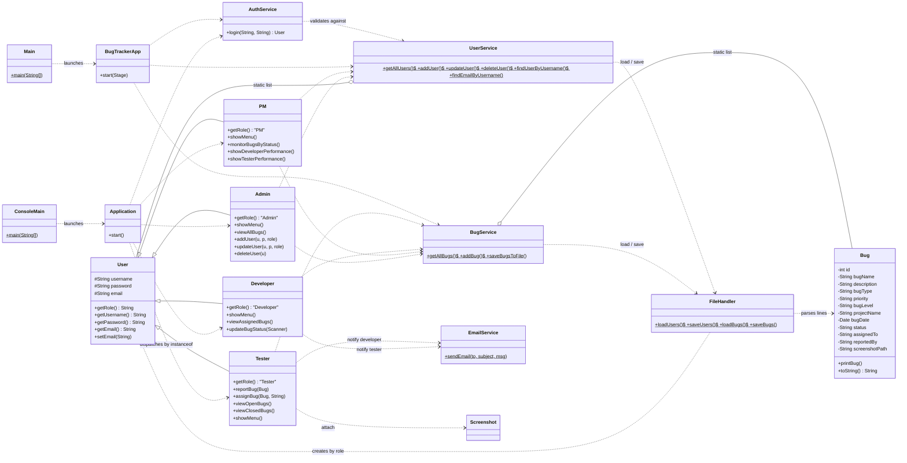
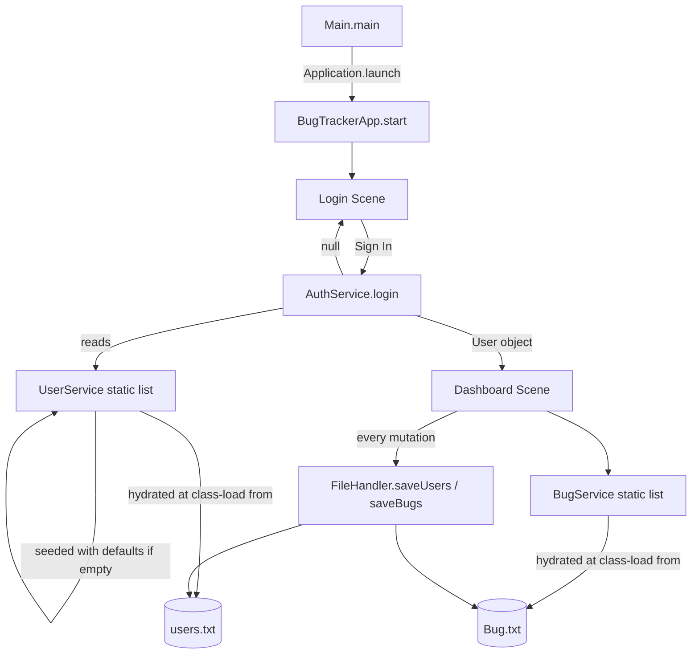
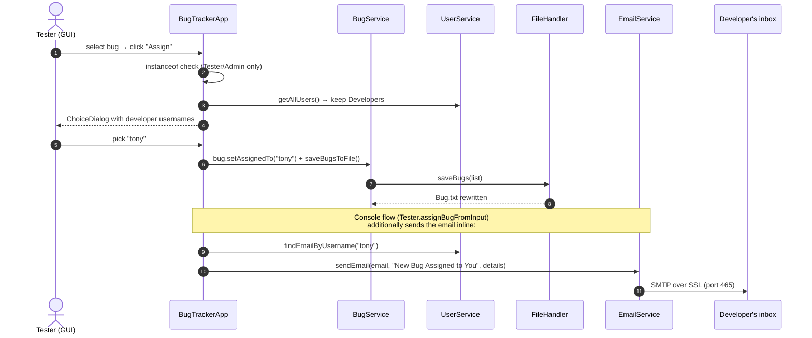
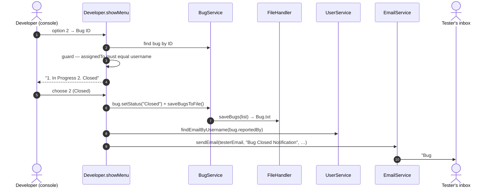

# 🏗️ Architecture

This document explains how the Bug Tracker System is put together: its layers, its classes,
how they interact, and why the design looks the way it does.

---

## 1. The Three Layers

Although the project has no framework, the classes fall naturally into three layers.
Dependencies only point **downward** — the model/persistence layer knows nothing about JavaFX,
and the services know nothing about which UI is on screen.

```
┌──────────────────────────────────────────────────────────────────────┐
│                              UI LAYER                                │
│                                                                      │
│  JavaFX path:  Main ──▶ BugTrackerApp (login scene → dashboard scene)│
│  Console path: ConsoleMain ──▶ Application (login loop → role menu)  │
│                              │                                       │
│                role menus:   ├── Tester.showMenu()                   │
│                              ├── Developer.showMenu()                │
│                              ├── PM.showMenu()                       │
│                              └── Admin.showMenu()                    │
│  helpers: Screenshot (Swing file chooser for console attachments)    │
└──────────────────────────────┬───────────────────────────────────────┘
                               │ uses
┌──────────────────────────────▼───────────────────────────────────────┐
│                           SERVICE LAYER                              │
│                                                                      │
│  AuthService    login(username, password) → User | null              │
│  BugService     static List<Bug>  — getAllBugs / addBug / save       │
│  UserService    static List<User> — add / update / delete / find     │
│  EmailService   sendEmail(to, subject, message) via SMTP             │
└──────────────────────────────┬───────────────────────────────────────┘
                               │ reads / writes through
┌──────────────────────────────▼───────────────────────────────────────┐
│                     MODEL + PERSISTENCE LAYER                        │
│                                                                      │
│  Bug (12 fields)      User ◀── Tester / Developer / PM / Admin       │
│  FileHandler  ⇄  users.txt , Bug.txt   (one CSV line per record)     │
└──────────────────────────────────────────────────────────────────────┘
```

### Why this shape?

- **Two UIs, one core.** `BugTrackerApp` (GUI) and `Application` + role `showMenu()` methods
  (console) call exactly the same services. Adding a third UI (e.g. a web front-end) would not
  touch the business logic.
- **Static services as an in-memory database.** `BugService` and `UserService` are effectively
  singletons (static state). Any class can reach the canonical lists without dependency
  injection — simple, at the cost of testability (see *Limitations* in the README).
- **Write-through persistence.** Every mutation (`addBug`, `assignBug`, `setStatus`,
  `addUser`, …) is immediately followed by `FileHandler.save…(list)`. There is no
  "dirty" state: the files always mirror memory.

---

## 2. Class Diagram



**Key inheritance idea:** roles *are* users. `UserService.createUser(username, password, role)`
is a small factory that maps the stored role string (`tester` / `developer` / `pm` / `admin`)
to the concrete subclass, so the rest of the program can treat everyone as `User` and narrow
with `instanceof` only where behaviour differs.

---

## 3. Startup & Data Flow



Two details worth knowing:

1. **Lazy class initialization does the loading.** `UserService` and `BugService` each have a
   `static { … }` block that calls `FileHandler.load…()` the first time the class is touched.
   If the file is missing or empty, demo records are inserted (and written back on the first
   save) — the app always starts with something to show.
2. **The GUI holds a mirror list.** `BugTrackerApp` copies `BugService.getAllBugs()` into an
   `ObservableList<Bug>` wrapped in `FilteredList` → `SortedList` for the table. `refresh()`
   re-syncs the mirror after every change; the *same* `Bug` objects are shared, so setters
   called in dialogs are instantly visible.

---

## 4. Sequence: Assign a Bug (with email)



> **GUI vs console difference:** in the *console* Tester menu, assigning a bug immediately
> triggers `sendEmailToDeveloper(...)`. The *JavaFX* dialog path updates and saves the bug but
> does not call `EmailService` — one of the small behavioural divergences between the two UIs.

---

## 5. Sequence: Close a Bug (console Developer flow)



The same guards exist in the GUI (`BugTrackerApp.updateStatus`): only a `Developer`, only for a
bug whose `assignedTo` matches their username (case-insensitive), with statuses restricted to
*In Progress* / *Closed*.

---

## 6. Persistence Format (summary)

`FileHandler` is the only class that touches the disk:

| File | Written by | Line format |
|---|---|---|
| `users.txt` | `saveUsers` | `username,password,role` (role via `getStoredRole`, an `instanceof` reverse-mapping) |
| `Bug.txt` | `saveBugs` | `id,name,description,type,priority,level,project,date(yyyy-MM-dd),status,assignedTo,reportedBy,screenshotPath` |

On load, lines are split with an explicit limit (`split(",", 3)` / `split(",", 12)`), short or
blank lines are skipped, dates that fail to parse become `null`, unknown roles are ignored, and
the legacy status `complete` is normalized to `Closed`. Full details:
[DATA_FILES.md](DATA_FILES.md).

---

## 7. Design Decisions & Trade-offs

| Decision | Benefit | Trade-off |
|---|---|---|
| Default package, flat class layout | Matches the course project; zero import noise | Not scalable; no namespace separation |
| Roles via inheritance (`User` subclasses) | Natural OOP; `instanceof` dispatch is easy to read | Adding a role touches `UserService`, `FileHandler`, `Application`, GUI guards |
| Static service lists | Global access, no wiring | Hard to unit-test; one JVM = one "database" |
| Flat files instead of SQL | Zero setup; files are human-readable and diffable | No transactions, no escaping of commas, no concurrency control |
| Write-through saves after every change | Files never stale | Full-file rewrite per mutation (fine at this scale) |
| Env vars for SMTP config | No secrets in the repo | Email silently unavailable until configured (graceful `try/catch` message) |
| Two UIs over shared services | Demonstrates UI/business-logic separation | Minor feature drift between GUI and console (e.g. email on assign) |
