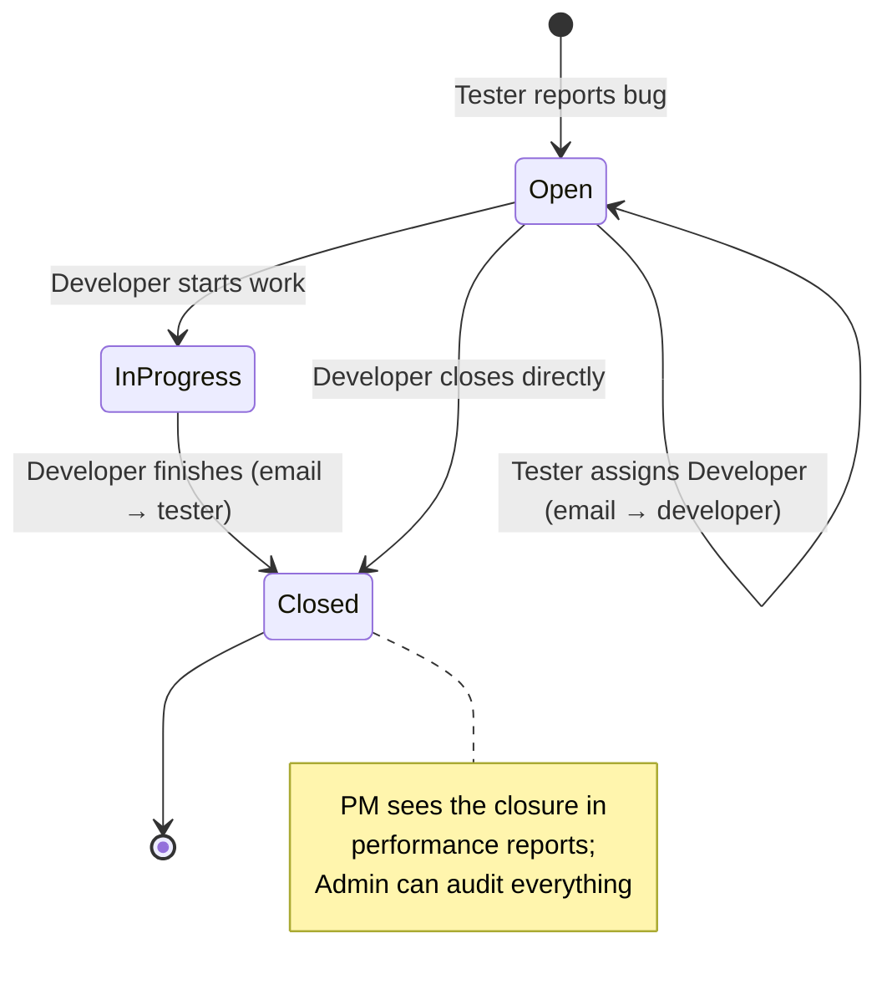

# 🎭 Roles & Permissions

Role-based access control (RBAC) is the core idea of this system: **who you are determines what
you can do and which interface you get.** Roles are modeled as subclasses of `User`
(`Tester`, `Developer`, `PM`, `Admin`), and every sensitive action starts with an `instanceof`
guard.

---

## 1. Role Overview

| Role | Class | `getRole()` | Mission in the workflow |
|---|---|---|---|
| **Tester** | `Tester.java` | `"Tester"` | Finds defects, files them into the system, routes them to the right developer, provides evidence (screenshots) |
| **Developer** | `Developer.java` | `"Developer"` | Owns the bugs assigned to them and moves them through *In Progress* → *Closed* |
| **Project Manager** | `PM.java` | `"PM"` | Monitors health of the process: bug counts and per-person performance rates (read-only) |
| **Admin** | `Admin.java` | `"Admin"` | Supervises everything: sees all bugs and owns the user accounts (create / update / delete, including choosing roles) |

Account creation is itself role-driven: the Admin picks one of the four role strings
(`tester` / `developer` / `pm` / `admin`) and `UserService.createUser(...)` maps it to the
matching subclass.

---

## 2. GUI Permission Matrix (`BugTrackerApp`)

Each toolbar button checks the logged-in user (`me`) before opening its dialog:

| Action (button) | Tester | Developer | PM | Admin | Guard message when refused |
|---|:---:|:---:|:---:|:---:|---|
| View table / search / sort / details / screenshot preview | ✅ | ✅ | ✅ | ✅ | — (available to all) |
| Refresh | ✅ | ✅ | ✅ | ✅ | — |
| **Report** (create bug) | ✅ | ❌ | ❌ | ✅ | “Only Tester/Admin can report.” |
| **Assign** (to a developer) | ✅ | ❌ | ❌ | ✅ | “Only Tester/Admin can assign.” |
| **Status** (In Progress / Closed) | ❌ | ✅ * | ❌ | ❌ | “Only Developer can update status.” |
| **Screenshot** (attach image) | ✅ | ✅ | ✅ | ✅ | — |
| **Insights** (counts & performance) | ❌ | ❌ | ✅ | ✅ | “Only PM/Admin can view insights.” |
| **Users** (add / update / delete) | ❌ | ❌ | ❌ | ✅ | “Only Admin can manage users.” |
| Logout | ✅ | ✅ | ✅ | ✅ | — |

\* A Developer passes the role guard **and** a second, per-record guard: the selected bug's
`assignedTo` must equal their username (case-insensitive), otherwise they get
“Bug is not assigned to you.” — developers can only change the status of *their own* bugs.

Additional implicit rules in the GUI:

- The **Assign** dialog only lists users whose class is `Developer` (you cannot assign a bug to
  a PM or another tester); if no developers exist it warns “No developers found.”
- Newly reported bugs automatically stamp `reportedBy = me.getUsername()`.
- The **Users** flow offers exactly the four canonical role strings.

---

## 3. Console Menus (`Application` + `showMenu()`)

After login the console prints `Welcome <Role>!` and hands over to that role's menu:

### Tester menu
```
1. Report a Bug            → prompts for name, type, priority, level, project, date, status
2. Assign Bug to Developer → validates the target is a Developer, then EMAILS them
3. Attach Screenshot to Bug→ Swing file chooser, image validation, 10 MB cap
4. View Open Bugs          → prints full details of every Open bug
5. View Closed Bugs        → prints full details (Closed or legacy Complete)
6. Exit
```

### Developer menu
```
1. View Assigned Bugs      → ID / Name / Status of bugs assigned to this user
2. Close Bug               → ownership check, then In Progress or Closed (+ EMAIL to reporter on Closed)
3. Exit
```

### Project Manager menu
```
1. Check Developer Performance → Assigned / Resolved / Completion % per developer
2. Check Tester Performance    → Reported / Closed / Closure % per tester
3. Monitor Open and Closed Bugs→ total counts by status
4. Exit
```

### Admin menu
```
1. View All Bugs           → one-line summary of every bug
2. Add User                → username, password, role (tester/developer/pm/admin)
3. Update User             → new password and role for an existing account
4. Delete User             → removes the account
5. Exit
```

---

## 4. Who Does What — the Bug Life-cycle



| Stage | Owner | Tools used |
|---|---|---|
| Discovery & filing | Tester | Report dialog/menu; screenshot attachment as evidence |
| Triage & routing | Tester (or Admin) | Assign → picks from the developer list; console path notifies by email |
| Fixing | Developer | Status → *In Progress*, then *Closed*; only for own bugs |
| Feedback loop | System | `EmailService`: “New Bug Assigned to You” / “Bug Closed Notification” |
| Oversight | PM | Bug counts, developer completion %, tester closure % |
| Governance | Admin | Full bug list + user CRUD |

---

## 5. How Permissions Are Implemented (patterns to notice)

1. **Type-based (coarse):** `if (!(me instanceof Tester) && !(me instanceof Admin)) → refuse.`
   The role *class* is the permission token; no permission tables or annotations needed.
2. **Record-based (fine):** the Developer status flow adds
   `me.getUsername().equalsIgnoreCase(b.getAssignedTo())` — ownership of the individual bug.
3. **Data-shaping:** some controls don't refuse, they *filter* — e.g. the Assign dialog only
   ever shows developers, so an invalid choice is unrepresentable.
4. **Graceful refusal:** every guard ends in an explanatory `Alert` (GUI) or printed message
   (console) instead of hiding the button, which keeps the UI uniform across roles while
   teaching the user what their role can't do.

> **Trade-off to be aware of:** these checks live in the UI layer. The services themselves
> (`BugService`, `UserService`) would accept any call — acceptable for a desktop teaching
> project, but in a client/server system the same rules must be re-enforced server-side.
